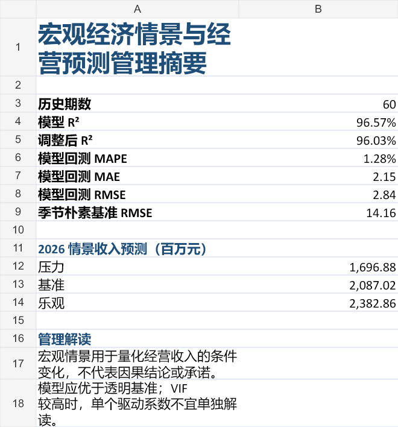

# 宏观经济情景与经营预测模型

[English](README.en.md) · 中文

[](https://github.com/wangyihanworld-ux/Macroeconomic-scenario-forecast-model/actions/workflows/tests.yml)

这是面向经济分析、财务 BP 和 FP&A 求职场景的作品集项目四。项目使用完全合成的数据，把 GDP 增长率、通胀率、失业率、消费者信心和汇率指数连接到月度经营收入，建立可解释的多元回归、滚动样本外回测及压力/基准/乐观情景预测。

> 月度经营 Demo 使用合成数据。新增的独立香港年度案例使用世界银行 WDI 公开数据，预测 GDP 增长率，不虚构企业营收。

## 2026-10-15 方法更新

- 月份标准化、连续性、有限数值、恒定收入、矩阵秩与情景预测期间校验。
- `rolling_backtest` 保留为条件回测：预测时已知当期宏观变量。
- `lagged_backtest` 单独按发布滞后假设回测：GDP 3个月，通胀/失业2个月，信心/汇率1个月；历史收入假设月末可得。输出预测时点及每个指标的来源月份。
- 两种误差分别展示，均不宣称使用历史实时数据版本。发布滞后是可配置假设，尚未逐次核对历史发布日期。
- [香港公开数据案例](docs/public-data-case.md)：原始响应、来源、校验值和离线复现。

## 报告预览

截图来自之前发布的合成 Demo；新生成的报告另含“滞后回测”工作表。

下图由一键 Demo 的完全合成数据报告生成，不包含真实企业或官方统计数据。



## 业务问题

- 宏观指标变化与经营收入有什么统计关联？
- 模型在未参与估计的月份上误差多大？
- 压力、基准和乐观假设下，下一年度收入区间如何变化？
- 财务 BP 应如何把模型结果转化为计划讨论，而不是把相关性误说成因果关系？

## 已实现

- 固定随机种子生成 60 个月合成历史数据和 36 条未来情景假设；
- 校验字段、日期、数值、重复月份、非正收入和重复情景键；
- 用最小二乘法估计五项宏观驱动及季节项；
- 输出 R²、调整后 R²、拟合值、残差与驱动系数；
- 采用前 36 个月起步的扩展窗口，对后 24 个月进行样本外滚动回测；
- 计算 MAE、RMSE 和 MAPE，并与季节朴素预测进行同窗口基准比较；
- 输出五项经济驱动的 VIF，共线性风险不再被高 R² 掩盖；
- 一键生成合成输入工作簿和含 9 张工作表的 Excel 管理报告；
- 31 项自动化测试覆盖数据契约、模型勾稽、回测、基准比较、VIF、情景方向和报告可重开。

## 一键运行

```powershell
python -m pip install -e .
python -m macro_forecast.demo
```

也可以使用安装后的命令：

```powershell
macro-forecast-demo --output-dir .\demo_output
```

输出文件：

- `合成宏观与经营输入.xlsx`
- `宏观经济情景与经营预测报告.xlsx`

## 运行测试

```powershell
python -m unittest discover -s tests -v
```

## 公开数据案例

在仓库根目录运行（默认离线）：

```powershell
python -m macro_forecast.public_case
```

仅在主动更新数据版本时增加 `--refresh`，并审查原始响应及结果变化。

## 方法边界

- 回归系数表示控制其他变量后的样本内统计关联，不等同于因果效应；
- 合成数据的拟合度和误差不能作为真实预测准确率承诺；
- 情景预测回答“假设这样变化会怎样”，不提供发生概率；
- 多重共线性、结构突变、滞后效应和外生冲击仍需在真实落地时进一步检验。

详细定义见 [数据字典与建模口径](docs/data-dictionary.md)，实施过程见 [项目计划](docs/project-plan.md)。


## Stronger baseline and interpretation

`python -m macro_forecast.benchmark_evidence` compares a calendar-only trend/season baseline with seasonal naive, conditional macro and lag-assumed macro on identical target months. The conditional model uses target-month macro variables, so its information advantage must remain visible.

Synthetic revenue is generated from a related linear family with low noise. High R² and low MAPE do not establish real-business predictive performance. The independent public WDI annual GDP case remains separate: percentage-point errors, small holdout sample, latest-vintage rather than real-time data. Preserve the modest improvement over a historical-mean baseline, without significance or causal claims.


## 2026年10月26日复核

本轮新增功能、规则来源和适用限制见 [复核记录](docs/review-20261026.md)。实现与自动测试有AI辅助，不能代表本人独立编写、用户试用或企业采用。历史测试数属于当时版本，本轮结果见交付证据。
